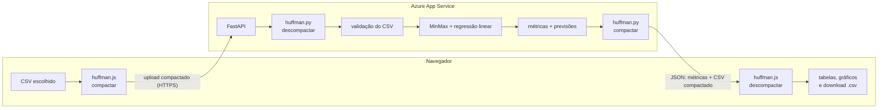

# Regressão Linear na Nuvem

Aplicação web que treina e executa, **na nuvem (Azure)**, uma regressão linear sobre uma série
temporal: o valor de um evento no momento atual (`time`) é previsto a partir das observações nos
5 momentos anteriores (`time-5` … `time-1`).

**Produção:** https://regressao-linear-d9527f.azurewebsites.net

## Como usar

1. **Treino:** envie o CSV de treino. A página mostra o desempenho esperado (RMSE, MAE e R², com
   média e desvio padrão) e um gráfico da série real × ajuste do modelo.
2. **Teste / aplicação:** envie o CSV de teste.
   - **Com a coluna `time`:** a página mostra a tabela **Esperado × Real × Diferença**, um gráfico
     da série real × predição e libera o download das previsões.
   - **Sem a coluna `time`:** a página só libera o download das previsões.
3. **Baixar previsões:** o arquivo `<nome>_previsoes.csv` traz as colunas originais mais a coluna
   `prediction`.
4. **Resetar modelo:** apaga o modelo para treinar em outra base.

> O modelo fica em memória. Se o app reiniciar (inclusive a cada deploy), ele volta ao estado
> "sem modelo" e é preciso treinar de novo.

## Requisitos do trabalho

| Requisito / critério | Onde está atendido |
|---|---|
| Upload de CSV para treino | Seção **Treino** → `POST /train` |
| Expectativa de desempenho após o treino | Validação cruzada temporal ([Decisões](#decisões-de-machine-learning)) |
| Teste **com rótulos**: previsões para download + desempenho real | Seção **Teste** → `POST /predict` |
| Teste **sem rótulos**: só as previsões | Mesmo endpoint, que detecta a ausência da coluna `time` |
| Tratamento de dados (min-max) | `MinMaxScaler` ajustado só no treino (`app/ml/model.py`) |
| Arquivos tratados ponta-a-ponta (compactar ou criptografar) | Compactação Huffman nos dois sentidos ([Huffman](#compactação-huffman)) |
| Reset do modelo | Botão **Resetar modelo** → `POST /reset` |
| **Treino em nuvem** (2 pts) | Azure App Service ([Deploy](#deploy-na-azure)) |
| **Execução em nuvem** para aplicação e teste (4 pts) | Azure App Service, com e sem rótulos |
| **Tratamento de dados ponta-a-ponta** (2 pts) | Huffman no navegador e no servidor + validação do CSV + min-max |
| **Comparação de desempenho real e esperado** (2 pts) | Tabela **Esperado × Real × Diferença** e gráfico do teste |

## Arquitetura



- **Backend:** Python 3.12, FastAPI, pandas e scikit-learn, num container Docker.
- **Frontend:** uma página HTML servida pela própria API. Os gráficos usam Chart.js (via CDN). Se o
  CDN não carregar, a página continua funcionando, só sem os gráficos.
- **Estado:** um único modelo global em memória, por isso o app roda com **uma instância**.

Diagrama original do grupo: [Excalidraw](https://excalidraw.com/#json=MPl7fA3qPLxtOvtaFTFKZ,yhAzFy-F5FQ58w4f1QVC9g).

## Formato dos dados

| Arquivo | Colunas (cabeçalho obrigatório, nessa ordem) |
|---|---|
| Treino e teste com rótulo | `time-5,time-4,time-3,time-2,time-1,time` |
| Teste sem rótulo | `time-5,time-4,time-3,time-2,time-1` |

- Formato: separador vírgula, UTF-8, só valores numéricos e nenhuma célula vazia.
- Limites: até 1 MB por arquivo. O treino exige pelo menos 30 linhas.
- Um CSV fora do formato é recusado com uma mensagem que diz qual coluna ou linha está errada.

## Decisões de machine learning

- **Modelo:** pipeline `MinMaxScaler` → `LinearRegression` (mínimos quadrados) do scikit-learn,
  isolado em `app/ml/model.py`.
- **Min-max sem vazamento de dados:** o scaler aprende mínimo e máximo **só com o treino**. No
  teste ele apenas transforma os dados. Na validação cruzada, é reajustado a cada fold.
- **Desempenho esperado com `TimeSeriesSplit(5)`:**
  - **Por quê:** é a escolha segura para série temporal. Ela nunca usa linhas posteriores para
    prever anteriores, então não arrisca uma estimativa otimista por vazamento do futuro.
  - **Como funciona:** cada fold treina com o início do arquivo e avalia no trecho seguinte (janela
    expansiva).
  - **Resultado:** o esperado é a média e o desvio padrão de RMSE, MAE e R² nos 5 folds. Depois
    disso, o modelo final é treinado com a base inteira.
  - **Conferência com a base do professor:** cada linha é uma janela independente; as linhas
    seguidas não são a mesma série deslocada. Por isso conferimos também um k-fold embaralhado,
    que deu praticamente o mesmo resultado: RMSE 83 com `TimeSeriesSplit` contra 85 com k-fold.
    A estimativa não depende da ordem das linhas.
- **Resultado com a base do professor:**

  | Métrica | Esperado (validação) | Real (teste) |
  |---|---|---|
  | RMSE | 83,1 ± 13,6 | 113,0 |
  | MAE | 60,7 ± 5,9 | 82,1 |
  | R² | 0,397 ± 0,110 | 0,311 |

  - **Erro absoluto maior que o esperado:** RMSE e MAE ficaram acima da faixa porque o teste é
    mais disperso que o treino (desvio padrão de `time` ≈ 136 contra ≈ 107).
  - **R² dentro da faixa:** o R² desconta essa dispersão, ou seja, o modelo explica a variação na
    proporção prevista.
  - **Melhor que a referência ingênua:** prever sempre a média do treino daria RMSE 140, contra
    113 do modelo (cerca de 20% a menos).
- **Comparação real × esperado:** o valor real fica **verde** quando está dentro da faixa esperada
  (média ± 1 desvio padrão) ou melhor que ela, e **vermelho** quando fica pior. "Melhor" significa
  erro menor para RMSE e MAE, e valor maior para R².

## Compactação Huffman

O enunciado pede para "compactar ou criptografar" os arquivos. Optamos pela compactação com
**Huffman Canônico**, implementada pelo grupo em duas linguagens:

- **Navegador** (`app/web/huffman.js`): compacta o CSV antes do upload e descompacta as previsões.
- **Servidor** (`app/huffman.py`): descompacta só em memória, sem gravar CSV em disco, e compacta
  o CSV de previsões, que volta em base64 dentro do JSON.

Pontos para a arguição:

- **Ganho:** um CSV numérico típico cai para cerca de 47% do tamanho. A página mostra o ganho de
  cada envio.
- **Compatibilidade:** as duas implementações geram **os mesmos bytes**, e há teste que verifica
  isso.
- **Arquivos inválidos:** o servidor recusa com 400 um CSV sem compactar ou um arquivo corrompido.

| Bytes | Conteúdo |
|---|---|
| 0–3 | Tamanho original, uint32 big-endian |
| 4–259 | Comprimento em bits do código de cada byte 0..255 (0 = byte ausente) |
| 260… | Códigos concatenados (bit mais significativo primeiro), completando o último byte com zeros |

**Por que só os comprimentos vão no cabeçalho:** como os códigos são canônicos (ordenados por
comprimento e depois pelo valor do byte), os comprimentos bastam para reconstruir a tabela.

**Checagens antes de descompactar:**
- a tabela precisa formar um código de prefixo completo;
- o tamanho declarado precisa caber no limite de 1 MB.

## API

| Método | Rota | Entrada | Saída |
|---|---|---|---|
| GET | `/health` | — | `{status, version}` (`version` = commit no ar) |
| GET | `/status` | — | `{trained, trained_at, n_rows, metrics}` |
| POST | `/train` | `file`: CSV compactado | RMSE/MAE/R² esperados (média e desvio) |
| POST | `/predict` | `file`: CSV compactado | `labeled`, `n_rows`, `metrics` (reais), `expected_metrics`, `predictions_huff` |
| POST | `/reset` | — | `{trained: false}` |

| Erro | Quando |
|---|---|
| 400 | Arquivo não compactado ou corrompido |
| 409 | Sem modelo treinado, ou treino em andamento |
| 413 | Arquivo acima de 1 MB |
| 422 | CSV fora do formato |

A documentação interativa fica em `/docs`. Para testar sem a página, use o
`scripts/huffman_cli.py`, que compacta e descompacta arquivos pela linha de comando.

## Rodar localmente

```bash
python -m venv .venv && source .venv/bin/activate
pip install -r requirements-dev.txt
python scripts/gerar_amostra.py   # CSVs de exemplo em data/
uvicorn app.main:app --reload     # página em http://localhost:8000
pytest
```

Com Docker: `docker build -t regressao-linear . && docker run --rm -p 8000:8000 regressao-linear`.

## Deploy na Azure

**Infraestrutura:**
- App Service Linux **B1** em `brazilsouth`, rodando o container com **uma instância**, só HTTPS e
  health check em `/health`.
- Imagem guardada num Azure Container Registry (ACR Basic).
- Custo de ~US$ 20–25/mês, debitados do crédito da Azure for Students.

**Deploy automático:**
1. Todo push na `main` dispara o `.github/workflows/deploy.yml`, que roda os testes.
2. Se os testes passarem, o workflow publica a imagem no ACR com a tag `latest`.
3. Um webhook do ACR avisa o App Service, que baixa a imagem e reinicia.
4. Em 3 a 5 minutos a versão nova está no ar, e o `/health` mostra o commit em `version`.

Pushes que só alteram `.md` não disparam o deploy.

> ⚠️ Cada deploy reinicia o app e **apaga o modelo treinado**. Não deem push na `main` durante a
> apresentação.

**Deploy manual** (cria a infraestrutura do zero) e remoção:

```bash
az login --use-device-code
BUILD=local ./scripts/deploy_azure.sh   # BUILD=local: a Azure for Students bloqueia o build no ACR
./scripts/destroy_azure.sh              # apaga tudo e para a cobrança
```

## Estrutura do projeto

```
app/
  main.py, config.py, errors.py, state.py   app FastAPI, configuração, erros e modelo em memória
  huffman.py                                compactação Huffman (servidor)
  api/routes.py                             endpoints; descompacta entradas e compacta saídas
  ml/validation.py                          leitura e validação do CSV
  ml/model.py                               pipeline MinMax + regressão, validação temporal, métricas
  ml/service.py                             casos de uso de treino e predição
  web/index.html                            interface
  web/huffman.js                            compactação Huffman (navegador)
  web/plots.js                              gráficos de treino e teste
scripts/                                    dados de exemplo, CLI do Huffman, deploy e remoção na Azure
tests/                                      validação, modelo, API e Huffman (inclui JS × Python)
.github/workflows/deploy.yml                testes e deploy automático
Dockerfile                                  imagem de produção
```
