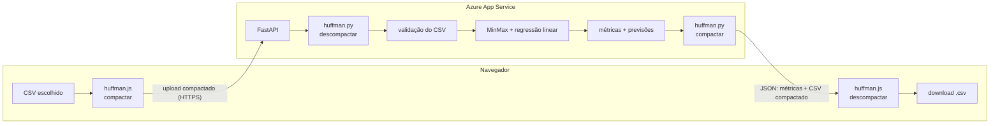

# Regressão Linear na Nuvem

Aplicação web que treina e executa, **na nuvem (Azure)**, uma regressão linear sobre uma
série temporal: o valor de um evento no momento atual (`time`) é previsto a partir das
observações nos 5 momentos anteriores (`time-5` … `time-1`).

**Produção:** https://regressao-linear-d9527f.azurewebsites.net

Pela página dá para treinar o modelo com um CSV, ver o desempenho esperado, testar com outro
CSV (com ou sem rótulos), comparar o desempenho real com o esperado, baixar as previsões e
resetar o modelo para treinar em outra base. Todos os arquivos trafegam **compactados com
Huffman** entre o navegador e o servidor.

## Como usar

1. Abra a URL de produção.
2. **Treino:** envie o CSV de treino. A página mostra o desempenho esperado (RMSE, MAE e R²,
   com média e desvio padrão).
3. **Teste / aplicação:** envie o CSV de teste.
   - **Com a coluna `time`:** a página mostra a tabela **Esperado × Real × Diferença** e libera o
     download das previsões.
   - **Sem a coluna `time`:** a página só libera o download das previsões.
4. **Baixar previsões:** o arquivo `<nome>_previsoes.csv` traz as colunas originais mais a coluna
   `prediction`.
5. **Resetar modelo:** apaga o modelo para treinar em outra base.

> O modelo fica em memória. Se o app reiniciar (inclusive a cada deploy), ele volta ao estado
> "sem modelo" e é preciso treinar de novo.

## Requisitos do trabalho

| Requisito / critério | Onde está atendido |
|---|---|
| Upload de CSV para treino | Seção **Treino** da página → `POST /train` |
| Expectativa de desempenho após o treino | Validação cruzada temporal no treino ([Decisões](#decisões-de-machine-learning)) |
| Upload de CSV de teste **com rótulos**: previsões para download + desempenho real | Seção **Teste** → `POST /predict` devolve métricas reais e o CSV de previsões |
| Upload de CSV de teste **sem rótulos**: só as previsões | Mesmo endpoint, que detecta a ausência da coluna `time` |
| Tratamento de dados (normalização min-max) | `MinMaxScaler` ajustado só no treino (`app/ml/model.py`) |
| Arquivos trabalhados ponta-a-ponta (compactar ou criptografar) | Compactação Huffman nos dois sentidos ([Compactação](#compactação-huffman-ponta-a-ponta)) |
| Reset do modelo para treinar em outra base | Botão **Resetar modelo** → `POST /reset` |
| **Treino em nuvem** (2 pts) | Azure App Service ([Deploy](#deploy-na-azure)) |
| **Execução em nuvem** para aplicação e teste (4 pts) | Azure App Service, com e sem rótulos |
| **Tratamento de dados ponta-a-ponta** (2 pts) | Huffman no navegador e no servidor + validação do CSV + min-max |
| **Comparação de desempenho real e esperado** (2 pts) | Tabela **Esperado × Real × Diferença** na página |

## Arquitetura



- **Backend:** Python 3.12, FastAPI, pandas e scikit-learn, num container Docker.
- **Frontend:** uma página HTML estática servida pela própria API, sem dependências externas.
- **Estado:** um único modelo global em memória, por isso o app roda com **uma instância**.

Diagrama original do grupo: [Excalidraw](https://excalidraw.com/#json=MPl7fA3qPLxtOvtaFTFKZ,yhAzFy-F5FQ58w4f1QVC9g).

## Formato dos dados

| Arquivo | Colunas (cabeçalho obrigatório, nessa ordem) |
|---|---|
| Treino | `time-5,time-4,time-3,time-2,time-1,time` |
| Teste com rótulo | `time-5,time-4,time-3,time-2,time-1,time` |
| Teste sem rótulo | `time-5,time-4,time-3,time-2,time-1` |

- Separador vírgula, codificação UTF-8 (com ou sem BOM), todos os valores numéricos e sem
  células vazias.
- Tamanho máximo: 1 MB.
- O treino exige pelo menos 30 linhas.
- Um CSV fora do formato é recusado com uma mensagem que diz qual coluna ou linha está errada.

## Decisões de machine learning

- **Modelo:** pipeline `MinMaxScaler` → `LinearRegression` (mínimos quadrados) do scikit-learn,
  isolado em `app/ml/model.py`.
- **Min-max sem vazamento de dados:**
  - O scaler aprende mínimo e máximo **só com o treino**. No teste ele apenas transforma, então
    os dados de teste nunca influenciam o modelo.
  - Dentro da validação cruzada, o scaler é reajustado a cada fold.
- **Desempenho esperado com `TimeSeriesSplit(5)`:**
  - **Por quê:** como é uma série temporal, embaralhar os dados (k-fold comum) deixaria o modelo
    treinar com o futuro e avaliar no passado, o que dá uma estimativa otimista demais.
  - **Como funciona:** usamos janela expansiva. Cada fold treina com o início da série e avalia
    no trecho seguinte, simulando o uso real.
  - **Resultado:** o desempenho esperado é a média e o desvio padrão de RMSE, MAE e R² nos 5
    folds. Depois disso, o modelo final é treinado com a base inteira.
- **Comparação real × esperado:**
  - Com um teste rotulado, as métricas reais são calculadas nas previsões e mostradas ao lado
    das esperadas.
  - O valor real fica **verde** quando está dentro da faixa esperada (média ± 1 desvio padrão)
    ou melhor que ela, e **vermelho** quando fica pior.
  - "Melhor" significa erro menor para RMSE e MAE, e valor maior para R².
- **Alternativa considerada:** implementar a regressão do zero, com **gradiente descendente**,
  em `numpy`.
  - É nesse cenário que a normalização min-max se torna indispensável, porque a solução de
    mínimos quadrados não depende da escala.
  - A troca só mexe em `_build_pipeline` (`app/ml/model.py`).

## Compactação Huffman (ponta-a-ponta)

O enunciado pede para "compactar ou criptografar" os arquivos; optamos pela compactação com
**Huffman Canônico**, implementada pelo grupo em duas linguagens:

- **Navegador** (`app/web/huffman.js`): compacta o CSV antes do upload e descompacta as previsões
  antes do download.
- **Servidor** (`app/huffman.py`): descompacta o upload só em memória, sem gravar CSV em disco,
  e compacta o CSV de previsões, que volta em base64 dentro do JSON.
- **Ganho:** um CSV numérico típico cai para cerca de 47% do tamanho. A página mostra o ganho
  de cada envio.
- **Teste de compatibilidade:** as duas implementações geram **os mesmos bytes**, e cada uma
  descompacta o que a outra gerou.
- **Arquivos inválidos:** o servidor recusa com **400** um arquivo que não esteja nesse formato,
  como um CSV em claro ou um payload corrompido.

Formato do arquivo compactado:

| Bytes | Conteúdo |
|---|---|
| 0–3 | Tamanho original, uint32 big-endian |
| 4–259 | Comprimento em bits do código de cada byte 0..255 (0 = byte ausente) |
| 260… | Códigos concatenados (bit mais significativo primeiro); o último byte é completado com zeros |

**Por que só os comprimentos vão no cabeçalho:** os códigos são canônicos, ou seja, ordenados
por comprimento e depois pelo valor do byte. Com essa regra, os comprimentos bastam para
reconstruir a tabela inteira.

**Checagens antes de descompactar:**
- a tabela precisa formar um código de prefixo completo;
- o tamanho original declarado precisa caber no limite de 1 MB, o que impede um arquivo pequeno
  de virar algo enorme ao descompactar.

## API

| Método | Rota | Entrada | Saída |
|---|---|---|---|
| GET | `/health` | — | `{status, version}` (`version` = commit no ar) |
| GET | `/status` | — | `{trained, trained_at, n_rows, metrics}` |
| POST | `/train` | multipart `file`: CSV compactado | RMSE/MAE/R² esperados (média e desvio) |
| POST | `/predict` | multipart `file`: CSV compactado | `labeled`, `n_rows`, `metrics` (reais, se rotulado), `expected_metrics`, `predictions_huff` (CSV compactado em base64) |
| POST | `/reset` | — | `{trained: false}` |

Erros, sempre com a mensagem em `detail`:

| Código | Quando |
|---|---|
| 400 | Arquivo não compactado ou corrompido |
| 409 | Sem modelo treinado, ou treino em andamento |
| 413 | Arquivo acima de 1 MB (compactado ou original) |
| 422 | CSV fora do formato |

Documentação interativa em `/docs`. Exemplo pela linha de comando:

```bash
python scripts/huffman_cli.py compactar data/treino.csv data/treino.huff
python scripts/huffman_cli.py compactar data/teste_com_rotulo.csv data/teste.huff
curl -F file=@data/treino.huff http://localhost:8000/train
curl -s -F file=@data/teste.huff http://localhost:8000/predict \
  | python -c "import sys,json,base64; sys.stdout.buffer.write(base64.b64decode(json.load(sys.stdin)['predictions_huff']))" > previsoes.huff
python scripts/huffman_cli.py descompactar previsoes.huff previsoes.csv
curl -X POST http://localhost:8000/reset
```

## Rodar localmente

```bash
python -m venv .venv && source .venv/bin/activate
pip install -r requirements-dev.txt
python scripts/gerar_amostra.py   # cria data/treino.csv, teste_com_rotulo.csv e teste_sem_rotulo.csv
uvicorn app.main:app --reload     # página em http://localhost:8000
pytest                            # 64 testes
```

Com Docker:

```bash
docker build -t regressao-linear .
docker run --rm -p 8000:8000 regressao-linear
```

Variáveis de ambiente (todas opcionais):

| Variável | Padrão | Função |
|---|---|---|
| `MAX_UPLOAD_BYTES` | 1048576 | Limite de tamanho do arquivo |
| `MIN_TRAIN_ROWS` | 30 | Mínimo de linhas no treino |
| `CV_SPLITS` | 5 | Número de folds da validação temporal |
| `MODEL_STORE_DIR` | `model_store` | Onde o modelo é salvo (limpo a cada start) |
| `APP_VERSION` | `dev` | Versão mostrada em `/health` (o deploy preenche com o commit) |

## Deploy na Azure

**Infraestrutura:**
- Web App for Containers num App Service Linux **B1**, região `brazilsouth`.
- **Uma instância**, porque o modelo é um estado global em memória.
- Só HTTPS, always-on e health check em `/health`.
- Imagem guardada num Azure Container Registry (ACR Basic).

### Deploy automático

Todo push na `main` dispara o workflow `.github/workflows/deploy.yml`:

1. Roda os testes. Se algum falhar, nada é publicado.
2. Constrói a imagem e envia para o ACR com a tag `latest`.
3. Um webhook do ACR avisa o App Service, que baixa a imagem nova e reinicia.
4. O workflow só fica verde quando `/health` responde com o commit novo em `version`.

O deploy leva uns 3 a 5 minutos. Pushes que só alteram arquivos `.md` não disparam o
workflow, para não reiniciar a produção à toa. Pull requests para a `main` só rodam os testes. Os secrets do
repositório são `ACR_LOGIN_SERVER`, `ACR_USERNAME` e `ACR_PASSWORD`.

> ⚠️ Cada deploy reinicia o app (cerca de 40 s fora do ar) e **apaga o modelo treinado**.
> Não deem push na `main` durante a apresentação.

### Deploy manual

Use o deploy manual para criar a infraestrutura do zero ou publicar sem passar pelo GitHub:

```bash
pip install azure-cli
az login --use-device-code
BUILD=local ./scripts/deploy_azure.sh   # cria o que faltar e publica a versão local
./scripts/destroy_azure.sh              # apaga tudo (para a cobrança)
```

- **Build da imagem:** a assinatura **Azure for Students** bloqueia o build na nuvem
  (ACR Tasks). Por isso, `BUILD=local` constrói a imagem com o Docker local.
  - No WSL sem integração com o Docker Desktop, passe `DOCKER=/mnt/c/.../docker.exe`.
- **Regiões:** a assinatura só permite `brazilsouth`, `canadacentral`, `chilecentral`,
  `mexicocentral` e `francecentral`.
- **Nomes dos recursos:** são derivados da assinatura, então recriar mantém a mesma URL.

**Custo:**
- B1 + ACR Basic ≈ **US$ 20–25/mês**, debitados do crédito de estudante.
- O GitHub Actions é grátis num repositório público.
- O custo não depende do número de deploys.
- O saldo do crédito aparece em microsoftazuresponsorships.com/Balance.

## Estrutura do projeto

```
app/
  main.py            criação do app FastAPI, tratamento de erros, página estática
  config.py          colunas, limites e variáveis de ambiente
  errors.py          erros de domínio → códigos HTTP
  state.py           modelo global em memória (troca atômica, 409 em treino simultâneo)
  huffman.py         compactação Huffman (servidor)
  api/routes.py      endpoints; descompacta entradas e compacta saídas
  ml/validation.py   leitura e validação do CSV
  ml/model.py        pipeline MinMax + regressão, validação temporal, métricas
  ml/service.py      casos de uso de treino e predição
  web/index.html     interface
  web/huffman.js     compactação Huffman (navegador)
scripts/
  gerar_amostra.py   gera CSVs sintéticos para testar
  huffman_cli.py     compacta/descompacta arquivos pela linha de comando
  deploy_azure.sh    cria a infraestrutura e publica na Azure
  destroy_azure.sh   apaga a infraestrutura
tests/               testes de validação, modelo, API e Huffman (inclui compatibilidade JS × Python)
.github/workflows/   testes e deploy automático
Dockerfile           imagem de produção
```

O planejamento completo (PRD e issues) está em `Regressão Linear na Nuvem PRD e Issues.md`.
